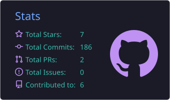
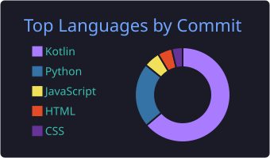

  

# Mynul Kabir Nayem

**CSE Undergraduate · Android, AI/RAG & Full-Stack Builder · Unity 6.3 / Godot Game Dev · Multimedia Creator**

Chittagong, Bangladesh

 

---

## About

I'm a final-year Computer Science & Engineering undergraduate at **International Islamic University Chittagong (IIUC)** and a **Multimedia Creator & Video Editor at Shoilpik Hometech** (`08/2024 – Present`). I bridge systems engineering and visual storytelling — building native Android apps, 3D multi-platform games, citation-backed RAG workflows, privacy-first web platforms, federated ML security research, and commercial video & photography work.

- 🌐 &nbsp;**Interactive Portfolio:** [mynul-portfolio-one.vercel.app](https://mynul-portfolio-one.vercel.app/) — built with **Next.js 15, React 19, TypeScript & Upstash Redis CMS**, featuring switchable **Stage Modes** (*Studio Orbit*, *Pinned Cinema*, *Creator Playground* physics HUD) and **Nothing Dot-Matrix** (`Doto`) variable typography
- 🎓 &nbsp;**Education & Thesis:** Final-year BSc in CSE @ **IIUC** — co-authoring **Fed-CrossIDS** (*Unpublished*), a 4-phase federated deep learning & explainability auditing framework (`PyTorch`, Expected Gradients, `LIME`) across `CICIoT2023`, `CICIoMT2024` & `GothamDataset2025`
- 📱 &nbsp;**Android & Privacy Web:** Created **[MuseFlow](https://github.com/Panduu3163/Muse_Flow)** (`Kotlin`, Jetpack Compose, Media3/ExoPlayer, 9 synced lyric styles, `V1.7.0_Beta`) and **Location Lab** (`Next.js 16`, Better Auth, PostgreSQL consent-first geolocation with visitor SHA-256 deletion)
- 🎮 &nbsp;**3D Game Dev:** Evolving **Chapabaz (`ChapabazUnity`)** — a 2–8 player 3D Bangladeshi bluffing card game — from **Godot 4.7 / GDScript** into an expanded private **Unity 6.3 LTS (URP 17.3 + Blender)** build for Play Store, App Store & Web
- 🤖 &nbsp;**AI / LLM & RAG:** Built **[FestGuide](https://github.com/Panduu3163/FestGuide)** for IIUC CSE Fest 2026 during CSE Industrial Training using **156 embedded Qdrant** vector chunks, source citations & a SQLite-checkpointed **LangGraph** organizer approval gate
- 🎬 &nbsp;**Creative Media:** Directing video production, editing, color grading, graphics design & **Xiaomi 14 Ultra · LEICA** photography @ **Shoilpik Hometech** (`Chittagong, Bangladesh`)
- 💼 &nbsp;**Open To:** Software engineering, Android/Full-Stack, AI/ML/RAG, game development & multimedia collaborations

---

## Featured Projects

<table>
  <tr>
    <td width="33%" valign="top">
      <h3><a href="https://github.com/Panduu3163/Muse_Flow">Muse Flow</a></h3>
      
Free, open-source Android music player built with Kotlin, Jetpack Compose, Material 3, Media3/ExoPlayer, 9 animated lyric styles & Listen Together (<code>V1.7.0_Beta</code>).

      
 

    </td>
    <td width="33%" valign="top">
      <h3><a href="https://github.com/Panduu3163/FestGuide">FestGuide</a></h3>
      
IIUC CSE Fest 2026 rulebook & registration assistant indexing 156 Qdrant chunks with citations and a SQLite-checkpointed LangGraph approval flow.

      
 

    </td>
    <td width="33%" valign="top">
      <h3><a href="https://mynul-portfolio-one.vercel.app/#projects">Chapabaz (Unity 6.3)</a></h3>
      
2–8 player Old Dhaka 3D bluffing card game evolving from Godot 4.7 GDScript into a private Unity 6.3 LTS (URP 17.3 + Blender) release for Play, iOS & Web.

      
 

    </td>
  </tr>
  <tr>
    <td width="33%" valign="top">
      <h3><a href="https://mynul-portfolio-one.vercel.app/#projects">Location Lab</a></h3>
      
Consent-first one-time browser geolocation & IP sharing platform with Next.js 16, Better Auth, PostgreSQL, 192-bit links & visitor SHA-256 deletion tokens.

      
 

    </td>
    <td width="33%" valign="top">
      <h3><a href="https://mynul-portfolio-one.vercel.app/#projects">Fed-CrossIDS (Thesis)</a></h3>
      
Unpublished IIUC BSc CSE thesis evaluating 4-phase federated learning & XAI auditing (Expected Gradients, LIME) across 3 IoT/IoMT intrusion datasets.

      
 

    </td>
    <td width="33%" valign="top">
      <h3><a href="https://mynul-portfolio-one.vercel.app/">Portfolio &amp; Studio CMS</a></h3>
      
Next.js 15 + Upstash Redis interactive portfolio with Studio Orbit, Pinned Cinema, Creator Playground physics HUD & Nothing Dot-Matrix Doto fonts.

      
 

    </td>
  </tr>
</table>

---

## Tech Stack

**Languages & ML**

**Web & Databases**

**Game Dev, Tools & Creative Media**

---

## GitHub Stats

