  

# Mynul Nayem

**Computer Science & Engineering student · Web & Android developer**

Chittagong, Bangladesh

 

---

## About

I'm a final-year Computer Science & Engineering student who enjoys turning ideas into working software, from full-stack web apps to Android apps, with a research interest in applying machine learning to network security.

- 🎓 &nbsp;Final-year BSc in CSE, International Islamic University Chittagong (IIUC)
- 🔭 &nbsp;Building web applications with the MERN stack, and Android apps in my spare time
- 🧠 &nbsp;Thesis work on machine learning for IoT and network intrusion detection
- 💼 &nbsp;Open to junior and entry-level software roles
- 💬 &nbsp;Happy to talk about PC hardware, mobile devices and general tech

---

## Tech Stack

**Languages**

**Web**

**Tools & Design**

---

## GitHub Stats

